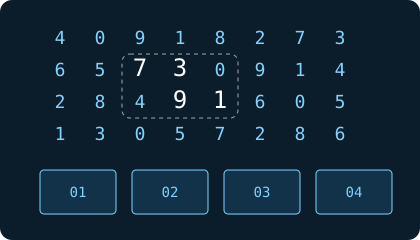

# Hackathon Frontend: Lumon Industries — Macrodata Refinement

<div align="center">
  
</div>

> *"El trabajo es misterioso e importante."*

---

## 👥 Datos del Equipo

- **TEAM_CODE:** `TEAM-067`
- **Nombre de Cuadrilla:** `Cuadrilla MDR Elias-Jasyr`
- **Integrantes:**
  - Elías Paz — Código: `202510360`
  - Jasyr Valdez — Código: `202510474`
- **Deploy:** URL de producción (Vercel / Netlify)
- **Storage:** Cloudinary / Supabase

---

## 🚀 Ejecución del Proyecto

```bash
# 1. Instalar dependencias (Node 24 LTS)
npm install

# 2. Iniciar servidor de desarrollo
npm run dev

# 3. Compilar para producción (TypeScript estricto)
npm run build
```

---

## ⚙️ Configuración y Primeros 20 Minutos

Todas las operaciones se pueden realizar directamente desde la interfaz web en la ruta `/integrations` o mediante los comandos CLI configurados:

```bash
# Inscribir roster de integrantes
npm run setup:roster

# Pedir token de verificación de dominio para despliegue
npm run setup:challenge https://<su-app>.vercel.app

# Verificar dominio en vivo desde producción
npm run setup:verify

# Registrar y verificar storage
npm run setup:storage CLOUDINARY <cloudName> <uploadPreset>

# Correr revisión automática de clearance
npm run setup:clearance
```

---

## 🛠️ Stack Tecnológico

- **React 19 + TypeScript (Modo Estricto)**
- **Vite 6**
- **Tailwind CSS v4** (`@tailwindcss/vite`)
- **React Router DOM v7**
- **Fetch API nativo** (sin Axios ni librerías prohibidas)
- **SSE nativo (EventSource)** con tickets efímeros y recuperación de estado
- **WebSocket nativo** para piso compartido en tiempo real (`/floor/ws`)
- **Motor MDR:** Algoritmo de detección de grupos por conectividad (BFS) y clasificación automática de cajas (**WO, FC, DR, MA**) respetando las reglas de temblor e idempotencia (`Idempotency-Key`).
